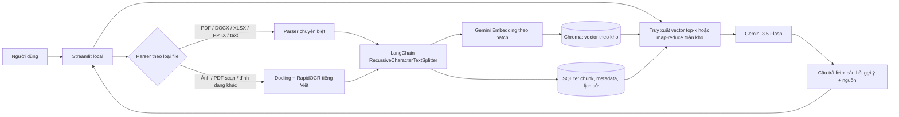

# Kịch bản giới thiệu Kho tri thức AI

Tài liệu này giúp trình bày demo trong khoảng 5–7 phút. Giao diện chính được giữ như chatbot; khi cần giải thích kỹ thuật, mở mục thu gọn **ℹ️ Cách ứng dụng xử lý tài liệu và quota** ở cuối trang.

## Câu chuyện của demo

> Nhân viên có nhiều file PDF, Word và bảng tính rời rạc. Thay vì tìm thủ công từng file, họ đưa chúng vào một kho, hỏi bằng ngôn ngữ tự nhiên và nhận câu trả lời kèm file, trang và đoạn nguồn để tự kiểm chứng.

## Sơ đồ kiến trúc

## Kịch bản 5–7 phút

1. **Giới thiệu vấn đề** — Nhiều tài liệu, cách gọi và định dạng khác nhau khiến tìm kiếm thủ công mất thời gian; câu trả lời không có nguồn thì khó tin cậy.
2. **Tạo kho** — Trong sidebar, tạo một kho, ví dụ `Quy trình nhân sự`. Giải thích rằng mỗi kho là một phạm vi hỏi đáp riêng.
3. **Nhập file đa dạng** — Bấm **Thêm tài liệu**, chọn một PDF có bảng, một DOCX có bảng và một PDF scan hoặc ảnh. Theo dõi trạng thái parser/chunk; mở mục **Tài liệu trong kho** để xem parser và từng chunk.
4. **Hỏi câu cụ thể** — Hỏi một dữ kiện có trong tài liệu. Mở **Nguồn đã dùng** để chỉ rõ tên file, trang, mã chunk, khoảng cách tìm kiếm và nội dung gốc.
5. **Hỏi câu rộng** — Chọn **Tổng hợp toàn kho** hoặc để **Tự động** rồi hỏi tóm tắt/so sánh nhiều tài liệu. Luồng này đọc riêng từng file, chia file lớn thành các phần để tổng hợp, rồi hợp nhất ghi chú. Câu hỏi đếm số file hoặc liệt kê file được trả từ danh mục kho, không gọi Gemini.
6. **Tiếp tục hội thoại** — Chọn một câu hỏi gợi ý. Chuyển qua lại lịch sử, đổi tên hoặc xóa hội thoại, rồi mở một cuộc trò chuyện mới để minh họa lịch sử được lưu riêng.
7. **So sánh kỹ thuật** — Trong mục nâng cao chọn **So sánh cơ bản và nâng cao**, hỏi cùng một câu. Dùng **Tiết kiệm API** để trình bày cấu hình ít gọi Gemini, sau đó bật mọi kỹ thuật và hỏi lại. Mở **Xem pipeline, nguồn và chi phí** để chỉ ra query rewrite, nguồn dense/BM25, rerank score, parent, nén, thời gian và token. Mở **So sánh cơ bản và nâng cao** để đối chiếu hai câu trả lời, file/trang/chunk, mức trùng nguồn và chênh lệch API calls/token.
8. **Giải thích quota** — Chỉ ra embedding được gom theo batch, app tự giãn nhịp và retry 429/503, giữ chunk đã đọc để lập chỉ mục lại sau lỗi quota.

### Demo kỹ thuật theo từng bước

Để trình bày chi tiết hơn, chọn **🧪 Phòng thử nghiệm từng bước** ở đầu ứng dụng. Chọn file mẫu, xem preview Chunk thường/Parent-Child rồi chốt một cách chia. Ở từng bước sau, đổi lựa chọn kỹ thuật là chạy và hiện ngay kết quả, còn nút tiếp tục chỉ chốt phương án đang xem. Planner có tám lựa chọn gồm từng kỹ thuật Query Rewrite, Multi-query, HyDE, ba tổ hợp đôi và cả ba; chỉ rõ query được rewrite, query phụ được tạo hoặc câu HyDE. Tiếp đó xem ngay kết quả Vector/Hybrid, thứ tự trước/sau reranker, context có/không nén và kết quả audit. Answer Grading/Citation Verification có lựa chọn riêng lẻ hoặc cùng lúc. Kết quả các bước đã chốt được giữ lại để người xem theo dõi input/output, nguồn, số API calls và token.

Mỗi tổ hợp planner mới có thể tốn một generation call; nếu quay lại tổ hợp đã chạy, preview được cache. Vector/Hybrid dùng chung embedding của cùng query nên đổi qua lại không gọi embedding lần nữa. Reranker, retrieval BM25 và dựng/nén context chạy cục bộ. Phòng thử nghiệm dùng collection Chroma tạm trong bộ nhớ và không làm thay đổi kho chat; cuối lượt có thể chủ động lưu file cùng cách chia đã chọn vào kho thật.

Ở bước context, hai bản không nén/có nén được trình bày cạnh nhau, kèm số ký tự/token và nguồn; chọn bản muốn gửi Gemini. Bước sinh câu trả lời giữ kết quả, nguồn, gợi ý và bộ đếm trên cùng màn hình trước khi tiếp tục. Chunk được ghi bằng số chunk/trang, và child cho biết Parent tương ứng thay cho ID kỹ thuật. Mở expander **Giải thích thuật ngữ, chỉ số, thông số và công thức** để giải thích Dense top, BM25, hợp nhất, RRF, reranker, quota và các công thức.

## Vấn đề và cách ứng dụng xử lý

| Vấn đề | Cách giải quyết trong demo | Cách trình bày / kiểm chứng |
| --- | --- | --- |
| Tài liệu nằm ở nhiều file | Tạo kho riêng và hỏi trên toàn bộ tài liệu sẵn sàng của kho | Chọn kho trong sidebar, hỏi một câu cần thông tin từ nhiều file |
| PDF scan hoặc ảnh không có text layer | Parser nhanh phát hiện trang ít chữ rồi chuyển Docling + RapidOCR tiếng Việt | Upload file scan, xem parser hiển thị ở trạng thái tài liệu |
| Bảng mất quan hệ giữa cột khi chia chunk | Bảng chuyển thành Markdown và tiêu đề cột được lặp lại ở các chunk bảng | Mở chunk của file có bảng và kiểm tra tên cột cùng các hàng |
| Trả lời khó kiểm chứng | Lưu nguồn kèm file, trang, chunk; mở lại nội dung chunk | Mở nguồn của câu trả lời, đối chiếu với tài liệu gốc |
| Tóm tắt/so sánh cả kho vượt ngữ cảnh | Map-reduce theo từng file | So sánh chế độ chi tiết và toàn kho |
| Quota RPM chạm ngay khi nhập một file | Gộp embedding theo batch, đặt nhịp gọi cục bộ, retry có backoff/jitter | Mở mục nâng cao; thử lập chỉ mục lại khi quota cho phép |
| Lỗi quota ngày hoặc billing | Nhận diện riêng, dừng retry vô ích và hướng người dùng tới AI Studio/billing | Đọc thông báo lỗi ở phần nhập liệu hoặc trạng thái file |
| Ứng dụng dừng giữa lúc nhập | Khi mở lại, đánh dấu thao tác dở thành lỗi và cho phép thử lại | Có thể dừng phiên demo trong lúc nhập rồi khởi động lại nếu muốn minh họa |
| Nhập trùng cùng một file | Băm SHA-256 trong phạm vi kho và bỏ qua bản trùng | Upload lại đúng file để xem thông báo bỏ qua |
| Chunk nhỏ thiếu ngữ cảnh | Parent-Child: vector tìm child, câu trả lời nhận parent lớn hơn | Mở chẩn đoán và xem số parent được dùng |
| Vector search bỏ sót khớp từ khóa | Hợp nhất Chroma dense và BM25 bằng reciprocal-rank fusion | Xem số candidate của từng nhánh |
| Câu hỏi ngắn/phụ thuộc lịch sử | Gộp Rewrite, Multi-query và HyDE trong một bước lập kế hoạch | Xem các query thực tế trong pipeline diagnostics |
| Trích dẫn sai hoặc câu trả lời yếu | Audit một lần chấm điểm và xác minh nguồn, không tự sửa lặp | Xem điểm, mã trích dẫn chưa hợp lệ và nguồn đã chọn |
| Kỹ thuật nâng cao khó demo tác động | Chạy baseline và advanced cùng một câu hỏi, lưu hai kết quả | So sánh câu trả lời, nguồn, latency và token |
| Planner/audit làm tăng request hoặc chạm RPM | Nút Tiết kiệm API tắt planner và audit nhưng vẫn giữ retrieval/rerank/nén local | So sánh API calls/token với cấu hình bật mọi kỹ thuật |
| Không biết kỹ thuật mới có cải thiện không | Bộ JSONL cố định chạy baseline/advanced cùng câu hỏi, đo source hit/recall, citations, abstention, latency và token | Mở **📊 RAG Evaluation**, chạy vài case rồi tải JSON/CSV |
| Retrieval sai nhưng câu trả lời vẫn được sinh | Corrective Retrieval chấm đúng context đã chọn để gửi câu trả lời, tìm lại tối đa một lần rồi abstain nếu vẫn thiếu | Bật công tắc trong cài đặt nâng cao và mở diagnostics của lượt hỏi |
| Khó biết pipeline chậm/lỗi ở node nào | Phoenix local nhận trace LLM và span query planning, retrieval, context, answer, audit, retry | Bật tracing tùy chọn, hỏi lại một case rồi mở UI Phoenix |

## Chuẩn bị trước buổi trình bày

- Tạo Gemini API key và kiểm tra model/hạn mức hiển thị trong AI Studio.
- Điền key vào `.env` (để trống thì nhập trong sidebar khi chạy).
- Chuẩn bị 2–3 tài liệu mẫu nhỏ, có ít nhất một bảng và một trang scan rõ nét; bảo đảm có vài câu hỏi mà câu trả lời nằm ở file khác nhau.
- Chạy `.\run.ps1` trước buổi demo để dependencies và model OCR có thời gian cài/tải lần đầu.
- Để xem quota khi demo, mở sẵn trang Rate limits của Google AI Studio; không đưa API key lên màn hình hoặc vào slide.
- Xóa dữ liệu demo bằng cách đóng app và xóa thư mục `data/` khi thực sự muốn làm sạch toàn bộ kho, lịch sử và vector.

## Phạm vi và giới hạn cần nói rõ

- Đây là demo chạy trên máy cá nhân; SQLite, file và Chroma lưu dưới `data/`. Gemini API nhận các chunk truy xuất cùng câu hỏi để tạo câu trả lời.
- Parser hỗ trợ nhiều định dạng văn bản, Office, PDF và ảnh; không có giải pháp nào đọc đúng mọi định dạng nhị phân, file lỗi/mật khẩu, bảng lồng phức tạp hoặc scan mờ. Office đời cũ có thể cần LibreOffice.
- OCR và phân tích layout chính xác hơn nhưng chậm hơn parser text; lần đầu có thể tải model weights.
- Chế độ toàn kho cần nhiều lời gọi Gemini hơn so với tìm top-k nên có thể chậm hoặc tiêu thụ quota hơn.
- Gợi ý câu hỏi và câu trả lời đều do AI sinh; nguồn giúp kiểm chứng nhưng người dùng vẫn nên đối chiếu nội dung quan trọng với file gốc.
- Giới hạn RPM trong ứng dụng chỉ điều tiết process demo này. Quota thật còn phụ thuộc project, model, tier, tokens, mức sử dụng bên ngoài app và billing.
- Tìm kiếm cơ bản lấy top-k chunk gần nhất theo cosine distance nhưng chưa có ngưỡng từ chối được hiệu chỉnh; câu hỏi ngoài phạm vi vẫn có thể gửi các đoạn gần nhất cho Gemini. Distance không phải xác suất đúng.
- Query Rewrite giữ tối đa một lượt hội thoại gần nhất làm ngữ cảnh; câu trả lời và citation vẫn cần dựa vào nguồn của lượt hỏi hiện tại.
- Nén ngữ cảnh có thể lược thông tin. Khi trình diễn bảng/số liệu, mở phần nguồn để đối chiếu hàng, cột và nội dung gốc.

## Kịch bản kiểm tra trước khi trình bày

Chạy thử cùng một bộ câu hỏi ngắn trước buổi demo: một dữ kiện có trong PDF, câu hỏi nối tiếp có đại từ khi bật Query Rewrite, một câu hỏi cần đọc bảng dài, câu hỏi về học vấn trong CV mẫu (nếu có trong kho), và một câu hỏi ngoài phạm vi. Với mỗi câu trả lời, xác nhận file/trang/đoạn nguồn có hỗ trợ nội dung. Ở câu hỏi ngoài phạm vi, mở distance và context để giải thích giới hạn top-k; không giới thiệu đây là cơ chế từ chối chắc chắn.

## Công nghệ sử dụng

| Thành phần | Công nghệ | Vai trò |
| --- | --- | --- |
| Giao diện | Python, Streamlit | Upload, tạo kho, chat, lịch sử và xem nguồn |
| Trích xuất | PyMuPDF, python-docx, openpyxl, python-pptx | Đọc nhanh PDF/Office và bảng |
| Fallback | Docling, RapidOCR | Layout, định dạng mở rộng, scan và ảnh tiếng Việt |
| Chunking | LangChain RecursiveCharacterTextSplitter | Tách theo ranh giới văn bản với overlap |
| Embedding | Gemini Embedding API | Chuyển chunk/câu hỏi thành vector; embedding theo batch |
| Vector search | Chroma | Tìm các chunk gần nghĩa trong từng kho |
| LLM | Gemini 3.5 Flash | Trả lời có nguồn và gợi ý câu hỏi tiếp theo |
| Metadata/lịch sử | SQLite | Kho, file, chunk, hội thoại và trích dẫn |
| Hybrid/Rerank | BM25 + FlashRank | Hợp nhất từ khóa/vector và xếp lại candidate local |
| Workflow | LangGraph StateGraph | Điều phối planner → retrieval → compression → answer → audit |
| Agentic workflow | LangGraph multi-agent | Supervisor chọn specialist, Synthesis tạo đầu ra, Critic kiểm tra nguồn |
| Kịch bản sản phẩm | SQLite + Streamlit wizard | Kịch bản nhiều bước, file đầu vào, phiên bản và lịch sử kết quả |
| Voice | Streamlit audio input + Gemini transcription + browser SpeechSynthesis | Nói thành câu hỏi, nghe câu trả lời mà không tạo TTS API call |
| Evaluation | Bộ JSONL + phép đo nguồn/citation/abstention/routing | So sánh baseline, advanced và multi-agent; lưu lịch sử run và tải CSV/JSON; LLM Judge là tùy chọn |
| Observability | Phoenix + OpenInference + OpenTelemetry | Xem provider spans, retrieval/context và từng agent; mặc định tắt, chạy local |

## Demo task mới: evaluation, trace và agentic loop

Chọn **📊 RAG Evaluation**, dùng kho có tài liệu khớp expected sources, chọn 3–6 case để chạy RAG cơ bản/nâng cao. Nếu thêm Multi-agent RAG, app giới hạn tối đa 3 case và hiển thị chi phí dự kiến. Dùng bộ demo 12 câu hỏi hoặc tải JSONL riêng. Đối chiếu source recall, câu trả lời, latency và tokens của cả ba pipeline; mở case để xem nguồn file/trang/chunk, route, từng specialist và reference answer. Bật LLM Judge cho ít case để trình bày correctness/groundedness/relevance; nhấn mạnh điểm judge có thể sai và cần kiểm tra thủ công.

Để demo Corrective Retrieval, bật **Tự đánh giá nguồn và tìm lại tối đa 1 lần**, hỏi case khó rồi mở **Xem pipeline, nguồn và chi phí**. Giải thích rằng app chấm mức đủ của context trước bước sinh, có thể tìm lại một lần và dừng nếu bằng chứng vẫn thiếu. Đây là vòng corrective retrieval có giới hạn, không phải agent tự do hay triển khai đầy đủ paper CRAG/Self-RAG.

Để demo trace, cài dependency riêng bằng `.\.venv\Scripts\python.exe -m pip install -r .\requirements-observability.txt`, đặt `PHOENIX_TRACING_ENABLED=true` trong `.env`, chạy `run-phoenix.ps1` ở terminal thứ nhất rồi khởi động Streamlit ở terminal thứ hai. Mở `http://localhost:6006` sau khi gửi một câu hỏi. Phoenix giúp xem provider span và node nào tốn thời gian; request Gemini vẫn đi qua API Google.

## Demo mentor: Agentic Design Patterns và kịch bản sản phẩm

1. Trong **📊 RAG Evaluation**, chọn cùng case và so ba pipeline Basic, Advanced, Multi-agent. Giữ khoảng 2–3 case khi bật Multi-agent để tránh tiêu thụ quota lớn.
2. Mở một case multi-agent, xem Supervisor chọn agent nào, từng specialist nêu gì, Synthesis và Critic kiểm tra câu trả lời ra sao. Chỉ ra input/token và latency tăng do nhiều agent cùng đọc một context.
3. Trong JSONL thêm `expected_agents` cho case. Chạy lại để thấy routing precision/recall/F1; giải thích đây là nhãn của người tạo dataset, không phải điểm đúng-sai nội dung.
4. Vào **🧭 Kịch bản sản phẩm**, tạo bản sao mẫu CV hoặc tạo scenario khác. Đi lần lượt các trường; bước `documents` upload/chọn file rồi giới hạn retrieval đúng phạm vi file đó.
5. Mở phần chi tiết để xem trace, nguồn, trang, chunk, token và route; xem lịch sử chạy lưu scenario version cùng kết quả.
6. Trở lại chat, mở **Hỏi bằng giọng nói**, ghi âm, sửa bản chép lời rồi gửi. Dùng nút loa để phát đáp án qua voice tiếng Việt của trình duyệt.

Giải thích ranh giới công nghệ: LangChain cung cấp Document/splitter/Chroma integration; LangGraph điều phối state/graph; agent là các vai trò Gemini riêng trong graph bounded. Specialist chạy tuần tự để kiểm soát RPM; hiện tại không phải agent song song hay agent tự do dùng tool.
