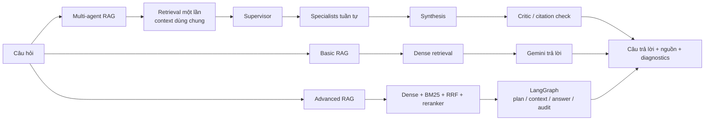
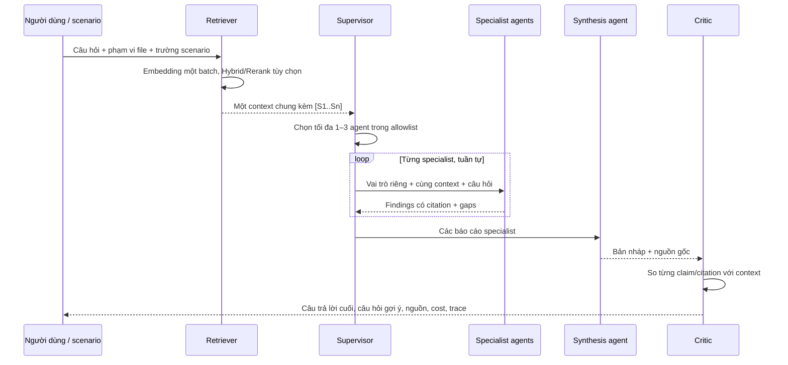

# LangChain và Agentic Design Patterns trong demo

## Mục tiêu trình bày

Project có hai lớp công việc cần phân biệt:

1. **Mentor 1 — kỹ thuật:** đo RAG cơ bản/nâng cao, quan sát từng bước và minh họa multi-agent có kiểm soát.
2. **Mentor 2 — sản phẩm:** đưa người dùng qua một kịch bản nhiều bước để cung cấp đầu vào và nhận kết quả có cấu trúc; hỗ trợ nói câu hỏi và nghe câu trả lời.

Khu vực **🧭 Kịch bản sản phẩm** kết nối hai lớp: người dùng chọn scenario và file, workflow multi-agent tạo đầu ra, còn diagnostics ghi lại bước chạy, nguồn và chi phí.

## LangChain đang được dùng ở đâu?

| Thành phần | Cách project dùng |
| --- | --- |
| `Document` | Chuẩn hóa nội dung cùng metadata trước khi lưu/tìm kiếm. |
| `RecursiveCharacterTextSplitter` | Chia tài liệu theo ranh giới đoạn/dòng/khoảng trắng, có overlap; hỗ trợ regular và parent-child. |
| `langchain-chroma` | Tích hợp vector store Chroma với giao diện document/embedding của LangChain. |
| Gemini adapter nội bộ | Thực hiện embedding/generation trực tiếp qua `google-genai`; batching, RPM gate, retry và RequestMeter được kiểm soát trong project. |
| LangGraph `StateGraph` | Giữ state, điều phối nhánh và node workflow. Dùng cho RAG nâng cao và multi-agent. |

Project **không** dùng một LangChain high-level retrieval chain dựng sẵn, LangChain Agent executor hay tool-calling tự do. Đây là chủ đích để từng request, quota, dữ liệu truyền vào và điều kiện dừng được nhìn thấy rõ trong buổi demo.

## Sơ đồ ba pipeline

## Multi-agent workflow

### Agent roles

- `evidence_analyst`: trích dữ kiện, tên riêng, con số, mốc thời gian.
- `table_analyst`: đọc header, đơn vị, hàng và quan hệ giữa các ô.
- `cross_document_analyst`: tìm điểm thống nhất/khác biệt giữa file.
- `requirements_analyst`: đối chiếu đầu vào với tiêu chí.
- `risk_analyst`: phát hiện mâu thuẫn, giả định và phần thiếu căn cứ.

Supervisor chỉ chọn từ các role được cấu hình trong scenario. Agent không được tự phát minh vai trò. Specialist chạy tuần tự thay vì song song vì mỗi call bị pacing theo RPM; cách này giảm burst và làm thứ tự trace dễ xem. Embedding/retrieval chỉ chạy một lần, sau đó tất cả chuyên viên dùng chung context.

## Chi phí và giới hạn

Với 2 specialist và Critic bật, mỗi lượt thường có:

| Thành phần | Tối đa |
| --- | ---: |
| Embedding | 1 batch |
| Supervisor route | 1 generation |
| Specialists | 2 generation |
| Synthesis | 1 generation |
| Critic | 1 generation |
| Tổng generation | 5 |

Số liệu là ước tính trước retry/quota; prompt lặp lại context ở từng agent nên input token có thể tăng đáng kể so với RAG đơn. Giảm specialist từ 2 xuống 1 hoặc tắt Critic để tiết kiệm. Evaluation giới hạn tối đa 3 case khi pipeline Multi-agent được chọn; LLM Judge nếu bật sẽ cộng thêm một generation call mỗi output.

Các ràng buộc chạy:

- 1–3 specialists; không có vòng lặp agent không giới hạn.
- Một retrieval/context cho mỗi lượt, có thể giới hạn `document_ids`.
- Supervisor chọn ID từ allowlist; output được ép schema JSON.
- Critic chạy tối đa một lượt; không có vòng self-revision lặp lại.
- RequestMeter lưu label, call count và usage token; khi provider không trả metadata, meter đánh dấu ước tính.
- Phoenix spans gồm `agent.supervisor.route`, `agent.specialist`, `agent.synthesis`, `agent.critic_citation_check`.

Đây là **supervisor–worker multi-agent workflow bounded**, không phải agent tự do dùng tool tùy ý. Các specialist cũng chưa chạy song song và chưa có message passing lặp lại; phần này phù hợp với demo thực tập cần giải thích được logic và quota.

## Evaluation và cách so sánh

Trong **📊 RAG Evaluation**, chọn cùng một JSONL case cho:

1. RAG cơ bản — dense top-k và một câu trả lời.
2. RAG nâng cao — retrieval hybrid/rerank và các công tắc đang bật.
3. Multi-agent RAG — retrieval một lần, điều phối role, tổng hợp và critic.

Giữ nguyên kho, dataset, top-k, model và corpus giữa các lần chạy. Đọc riêng các chiều:

- expected source hit/recall/precision: liệu đúng file có được truy xuất;
- citation ID validity: citation có trỏ về nguồn trả ra;
- abstention: câu không trả lời được có từ chối phù hợp không;
- agent selection precision/recall/F1: chỉ tính khi JSONL có `expected_agents`;
- latency, API calls, input/output token;
- answer/ref/context và agent report để spot-check thủ công.

`expected_agents` là nhãn do người tạo dataset khai báo, không phải chân lý tự sinh. Nếu một câu hỏi hợp lý cần nhiều vai trò, khai báo nhiều agent. Metric định tuyến không chứng minh nội dung câu trả lời đúng. LLM Judge cũng chỉ là tín hiệu; cần xem tài liệu gốc.

Run evaluation được lưu trong SQLite cùng hash dataset, cấu hình và kết quả để so sánh lại. JSON/CSV là artifact tiện tải/chia sẻ. Phoenix là observability theo thời gian chạy, còn evaluation là đo trên tập câu hỏi đã gán nhãn; hai việc bổ sung cho nhau.

## Kịch bản sản phẩm

Kịch bản là cấu hình được lưu có version, gồm:

- tên, mô tả sản phẩm đầu ra;
- các bước nhập `text`, `textarea`, `choice` hoặc `documents`;
- danh sách agent được phép supervisor chọn;
- trạng thái bật/tắt.

Khi có bước `documents`, user chọn file hoặc upload file vào kho ngay tại bước đó. Retrieval giới hạn dense query và BM25 đúng vào các `document_id` đã chọn; các agent nhận chung context này. Mỗi lượt lưu snapshot scenario version, inputs, file, result, source và diagnostics. Việc sửa scenario tạo version tiếp theo, không ghi đè snapshot lịch sử.

## Voice

- **Speech-to-text:** `st.audio_input` ghi WAV trên trình duyệt, Gemini tạo transcript; người dùng sửa/xác nhận transcript trước khi app gửi câu hỏi.
- **Text-to-speech:** nút đọc dùng Web Speech API với locale `vi-VN`; không tạo thêm request Gemini. Giọng có sẵn phụ thuộc máy/trình duyệt.
- Request nhận dạng được cộng vào meter của câu trả lời kế tiếp. Nếu provider không trả usage metadata, ước tính token có thể không bao gồm đầy đủ waveform audio.

## Buổi demo gợi ý

1. Chọn một file mẫu, hỏi cùng một câu bằng Basic và Advanced; so nguồn, latency/token.
2. Chạy cùng case trong Multi-agent; cho xem Supervisor chọn role nào, từng findings, synthesis và critic.
3. Mở RAG Evaluation và so 3 pipeline trên 2–3 case; chỉ ra cả case tốt và kém.
4. Mở Phoenix local để xem span theo agent khi tracing bật.
5. Tạo/chỉnh scenario, thêm file, đi qua từng trường, xem kết quả được giới hạn đúng trong file đã chọn.
6. Ghi âm một câu hỏi, sửa transcript, gửi; bấm loa để phát câu trả lời.
7. Kết luận trade-off: multi-agent tăng độ phân vai nhưng tăng prompt/token/độ trễ; muốn giữ chất lượng phải đo trên nhãn và trace, không chỉ xem một ví dụ đẹp.
